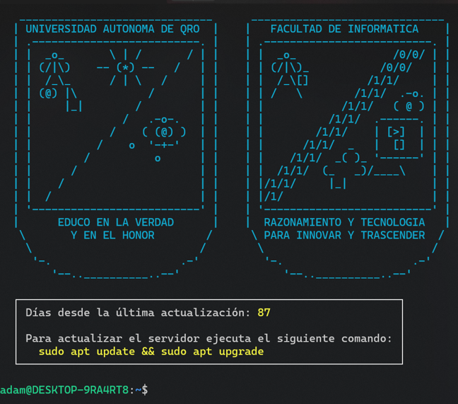

# uaq-update-reminder

Script de bash diseñado para ser autocargado en un .bashrc donde se muestren logos de la UAQ y la facultad de informatica junto a un recordatororio de cuantos días han pasado desde la última actualizacion y de como actualizar un sístema basado en Ubuntu.



## Instalación

Para que se muestre cada vez que se abre una terminal, agregarlo al final de `~/.bashrc`

### 1. Descargar el repositorio

Clona el repositorio en una ubicación permanente, por ejemplo `~/.local/bin/uaq-update-reminder`:

```bash
git clone <url> ~/.local/bin/uaq-update-reminder
```

### 2. Dale permisos de ejecución

```bash
chmod +x ~/.local/bin/uaq-update-reminder/script.sh
```

### 3. Agregalo al `~/.bashrc`

Abre `~/.bashrc` con nano, vim o cualquier editor de texto

Y agrega esta línea al final del archivo:

```bash
bash ~/.local/bin/uaq-update-reminder/script.sh
```

O desde la terminal:

```bash
echo 'bash ~/.local/bin/uaq-update-reminder/script.sh' >> ~/.bashrc
```

### 3. Aplicar los cambios

Abre una nueva terminal o recarga la configuración:

```bash
source ~/.bashrc
```

## Como quitar el programa

Elimina la línea de tu `~/.bashrc` y borra la carpeta del script:

```bash
rm -rf ~/.local/bin/uaq-update-reminder
```